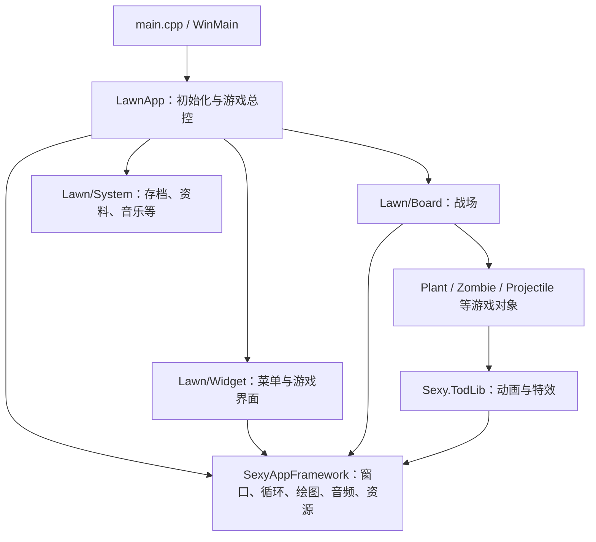

# re-plants-vs-zombies

[English / 上游原始说明](README_en.md)

《植物大战僵尸》初代的非官方 C++ 重实现与扩展项目。本仓库基于已有的逆向工程项目继续开发，包含游戏逻辑、SexyAppFramework 引擎和 TodLib 动画特效代码，可用于阅读实现、修改玩法和开展二次开发。

当前已在 Windows 上使用 CLion 2025.3.1、MinGW GCC 13.1.0、CMake 4.2 和 Ninja 完成 Debug 编译及链接，并使用本机 Steam 版资源验证了点击开始、主菜单显示、选项窗口、成就页往返和正常退出。完整关卡流程尚未验证，仓库仍包含未完成的实现。

## 当前状态

- 使用 C / C++，C++ 标准为 C++23，通过 CMake 构建。
- 主要开发与验证环境为 Windows，代码仍依赖 Win32、DirectDraw / Direct3D 和 DirectSound 等接口。
- 原项目提出了 GLFW 和跨平台迁移目标，当前构建仍使用旧渲染代码，不能据此视为已经完成迁移。
- 包含冒险关卡、植物、僵尸、商店、图鉴、禅境花园，以及成就和 Zombatar 等相关代码；存在代码并不代表对应功能已经完整可用。
- 仓库不包含原版游戏的完整美术、音乐和其他运行资源。运行需要自行准备合法获得的原版游戏文件。

## 快速开始

### 获取源码

```powershell
git clone https://github.com/Interweave05/re-plants-vs-zombies.git
cd re-plants-vs-zombies
```

### 使用 CLion 构建

1. 打开仓库根目录，即包含 `CMakeLists.txt` 的目录。
2. 在 **Settings → Build, Execution, Deployment → Toolchains** 中选择 CLion 自带的 MinGW，并确认 C / C++ 编译器能够被识别。
3. 在 CMake 配置中选择 **Debug**、**Ninja**，构建目录使用 `cmake-build-debug`。
4. 等待 CMake 配置完成，选择 `LawnProject` 目标并构建。

使用上述配置时，生成文件位于：

```text
cmake-build-debug/SexyAppFramework.exe
```

`PlantsVsZombies` 是顶层 CMake 项目名，`LawnProject` 是构建目标，`SexyAppFramework.exe` 是最终可执行文件名。

### 使用命令行构建

先确认 Git、CMake、Ninja 和 MinGW 的 `gcc`、`g++`、`windres` 已加入当前终端的 `PATH`，再在仓库根目录执行：

```powershell
cmake -S . -B cmake-build-debug -G Ninja -DCMAKE_BUILD_TYPE=Debug
cmake --build cmake-build-debug --target LawnProject -j 12
```

如果当前构建目录已由 CLion 配置，可直接执行第二条命令。不要在同一构建目录混用不同编译器或生成器；切换工具链时使用新的构建目录。

### 构建依赖

以下库通过 `ExternalProject_Add` 在首次构建时从 GitHub 下载并编译，无需手动把源码放入仓库：

| 依赖 | 固定版本 | 用途 |
| --- | --- | --- |
| zlib | `v1.3` | 压缩数据处理 |
| libjpeg-turbo | `3.0.1` | JPEG 图片读取 |
| libpng | `v1.6.40` | PNG 图片读取 |

相关配置位于 [`SexyAppFramework/imagelib/CMakeLists.txt`](SexyAppFramework/imagelib/CMakeLists.txt)。下载源码、库文件和生成的头文件均存放在构建目录内，因此首次构建需要能访问 GitHub。

默认保留编译警告，但不将警告视为错误。需要严格检查时可启用：

```powershell
cmake -S . -B cmake-build-debug -DPVZ_WARNINGS_AS_ERRORS=ON
```

当前顶层 `CMakeLists.txt` 仍直接设置 `CMAKE_BUILD_TYPE` 为 `Debug`，本文仅说明已验证的 Debug 构建。单配置生成器下，单独传入 `-DCMAKE_BUILD_TYPE=Release` 不会覆盖该设置。

## 运行与调试

编译生成的是程序本体，需要配合原版资源和音频动态库使用。推荐在构建目录准备运行文件，示例布局如下：

```text
cmake-build-debug/
├── SexyAppFramework.exe
├── bass.dll                 # 与程序位数匹配的 BASS 2.4 动态库
├── main.pak                 # 从本机原版游戏目录复制
└── properties/              # 从本机原版游戏目录复制
```

从 [BASS 官方网站](https://www.un4seen.com/bass.html)下载 Windows 开发包。当前已验证的程序是 64 位，需要将压缩包中 **`x64/bass.dll`** 复制到可执行文件旁边；压缩包根目录的 `bass.dll` 为 32 位版本，原版游戏自带的 DLL 也可能与当前程序位数不匹配。保留下载包中的 `bass.txt`，供查看版本和许可信息。

在 CLion 的 Run/Debug 配置中，将 **Working directory** 设置为准备好这些文件的构建目录，再运行 `LawnProject`。也可以把新程序和匹配的音频 DLL 放入单独准备的游戏资源目录副本，从该副本运行。

源码会读取 `main.pak`、`properties/resources.xml`、`Properties/LawnStrings.txt` 等资源路径，并根据资源清单继续加载图片、字体、音效和动画。部分文件可以由 PAK 资源系统提供，不一定全部以独立文件夹存在。

遇到 `Can't find bass.dll.` 时，先检查 DLL 是否放在正在运行的可执行文件旁，以及其位数是否匹配。当前代码将加载失败统一显示为这个提示，因此 DLL 文件存在时也可能是架构或依赖不兼容。仅修改工作目录不能代替准备匹配的 DLL。

原版资源、音频 DLL 和本地运行文件不应提交到源码仓库；放在 `cmake-build-debug/` 中会由 `.gitignore` 忽略。主菜单启动验证未覆盖所有游戏功能和资源版本的兼容性。

### 分类设置与显示模式

设置沿用原版墓碑背景、石质按钮、字体和绿色确认按钮，分为 **Sound（声音）**、**Display（显示）**、**Game（游戏）** 三页。声音页调整音乐与音效；显示页提供显示模式下拉菜单和原有 3D 加速选项；游戏页根据当前场景显示图鉴、重开、返回主菜单或制作人员名单。

在 **Display → Display Mode** 中选择：

| 模式 | 行为 |
| --- | --- |
| Windowed | 原版 800×600 普通窗口 |
| Original Fullscreen | 保留原版独占全屏及其显示模式切换 |
| Borderless Fullscreen | 无边框全屏，沿用桌面分辨率，按 4:3 居中显示 |

显示模式与 3D 设置在确认或关闭设置时应用，音量即时生效。按 **Alt+Enter** 在普通窗口和上次选择的全屏类型之间切换；未选择过全屏类型时沿用原版全屏。正常退出后保存选择。

分类支持鼠标、左右方向键或 Tab 切换。在显示页按向下方向键可展开下拉菜单，再用上下方向键与 Enter 选择；Esc 或点击外部可收起菜单。

默认允许游戏在后台继续运行：鼠标移出画面、点击其他窗口或最小化时，不会因为失去焦点自动弹出暂停框。需要原版行为时，可在 **Game → Pause When Unfocused** 中开启失焦暂停；此选项即时生效并在正常退出后保存。空格键手动暂停、打开设置和其他模态菜单时的暂停仍然保留。

无边框全屏保持原版 **800×600（4:3）** 的逻辑画面，等比缩放后居中显示。宽屏左右留黑边；比 4:3 更窄的屏幕上下留黑边。例如 1920×1080 显示器上，游戏画面为 1440×1080，左右各留 240 像素。鼠标位置同步映射到游戏坐标，黑边不响应游戏点击。

设置页入口、分类与控件布局位于 `Lawn/Widget/NewOptionsDialog.*`。新增分类时扩展 `SettingsPage` 和分类名称表，并在 `SelectPage()`、`Resize()`、`Draw()` 中添加对应控件的可见性、布局和内容；原有控件可在分类之间保留尚未应用的选择。

已在 1920×1080、软件渲染环境下验证分类、下拉菜单、三种模式切换、设置保存、鼠标映射、黑边点击隔离、成就页返回和显示变化后的窗口重建。当前机器的引擎检测结果不支持 3D 加速，3D 路径尚未实测。缩放计算另有覆盖 2K、4K、超宽屏、竖屏和奇数尺寸的独立检查，可在项目根目录用 MinGW 运行：

```powershell
g++ -std=c++23 -ISexyAppFramework tools/test-presentation.cpp -o cmake-build-debug/test-presentation.exe
.\cmake-build-debug\test-presentation.exe
```

## 项目结构

```text
re-plants-vs-zombies/
├── main.cpp                      # WinMain 入口，创建并启动 LawnApp
├── LawnApp.cpp / LawnApp.h        # 应用生命周期、资源加载、界面切换、游戏总控
├── ConstEnums.h                  # 植物、僵尸、关卡、动画等类型和状态枚举
├── GameConstants.h               # 场地尺寸、关卡数量、时间间隔等常量
├── Resources.cpp / Resources.h   # 图片、字体、声音等资源对象及提取绑定
├── Lawn/                         # 游戏玩法层
│   ├── Board.cpp / Board.h       # 战场管理、刷怪、更新、绘制和交互
│   ├── Plant.cpp / Plant.h       # 植物行为、攻击和生产逻辑
│   ├── Zombie.cpp / Zombie.h     # 僵尸行为、状态和受伤逻辑
│   ├── Projectile.*              # 子弹运动、碰撞和命中效果
│   ├── SeedPacket.*              # 种子卡片、费用和冷却逻辑
│   ├── Challenge.*               # 挑战模式与特殊规则
│   ├── Coin.* / LawnMower.*      # 掉落物、收集物和小推车
│   ├── ZenGarden.*               # 禅境花园玩法
│   ├── System/                   # 存档、玩家资料、音乐、游戏动画定义等
│   └── Widget/                   # 主菜单、选卡、商店、图鉴、设置等游戏界面
├── Sexy.TodLib/                  # 动画、粒子、特效和游戏辅助设施
│   ├── Reanimator.*              # Reanimation 动画播放
│   ├── ReanimAtlas.*             # 动画图集
│   ├── TodParticle.* / Trail.*   # 粒子和拖尾效果
│   ├── Attachment.*              # 特效与对象之间的挂接
│   ├── EffectSystem.*            # 特效对象的统一管理
│   ├── Definition.*              # 动画、特效等定义数据处理
│   ├── DataArray.h / TodList.*   # 对象容器和分配辅助
│   └── TodCommon.* / TodDebug.*  # 公共工具与调试支持
├── SexyAppFramework/             # 底层引擎和主可执行目标的构建定义
│   ├── SexyAppBase.* / SexyApp.* # 窗口、消息循环、资源和应用基础能力
│   ├── graphics/                 # 绘图、图像、字体和旧版 DirectX 渲染
│   ├── sound/                    # 音效、音乐及 BASS / FMOD 加载接口
│   ├── widget/                   # 通用控件、事件和控件管理器
│   ├── imagelib/                 # 图像解码封装与外部图片库构建
│   ├── paklib/                   # PAK 资源包访问
│   ├── ogg/                      # 内置 Ogg / Vorbis 解码代码
│   ├── misc/                     # XML、资源管理、数学、线程及错误处理工具
│   └── unused/                   # 历史保留代码，未列入当前构建
├── CMake/                        # 构建属性和公共 CMake 函数
├── CMakeLists.txt                # 顶层构建入口、编译参数和警告选项
├── CMakeSettings.json            # 保留的 Visual Studio CMake 配置
├── toolchain.cmake               # 面向 Windows 的交叉编译工具链配置
├── configure.sh / install.sh     # 原项目的交叉构建及本地部署脚本
├── tools/                        # PAK 和动画定义研究辅助工具
├── README_en.md                  # 保留的上游英文说明
└── LICENSE                       # 仓库附带的许可证文本
```

`Lawn/Widget` 是具体游戏界面，`SexyAppFramework/widget` 是支撑这些界面的通用控件系统。`Lawn/System` 包含与游戏内容绑定的系统，`Sexy.TodLib` 提供可被玩法调用的动画和特效设施。

### 程序如何连接起来



入口依次创建 `LawnApp`，调用 `Init()`、`Start()` 和 `Shutdown()`。应用初始化时加载资源和玩家信息、创建标题界面，随后由框架消息循环驱动界面与游戏对象更新。进入对局后，`Board` 统一组织战场对象的更新与绘制。

## 二次开发从哪里开始

| 想修改的内容 | 优先阅读 |
| --- | --- |
| 游戏启动、全局状态、菜单切换 | `main.cpp`、`LawnApp.cpp` |
| 阳光生成、刷怪节奏、战场规则 | `Lawn/Board.cpp`、`GameConstants.h`、`Lawn/Challenge.cpp` |
| 植物攻击、生产与种子卡属性 | `Lawn/Plant.cpp`、`Lawn/SeedPacket.cpp`、`ConstEnums.h` |
| 僵尸移动、攻击、受伤与特殊技能 | `Lawn/Zombie.cpp`、`ConstEnums.h` |
| 子弹轨迹、碰撞与伤害 | `Lawn/Projectile.cpp` |
| 菜单、选卡、商店和图鉴 | `Lawn/Widget/` |
| 存档和玩家进度 | `Lawn/System/SaveGame.cpp`、`PlayerInfo.cpp`、`ProfileMgr.cpp` |
| 动画与粒子效果 | `Sexy.TodLib/`、`Lawn/System/ReanimationLawn.cpp` |
| 图片、字体、音频资源的加载与绑定 | `Resources.cpp`、`SexyAppFramework/misc/ResourceManager.cpp` |
| 渲染或窗口系统 | `SexyAppFramework/graphics/`、`SexyAppFramework/SexyAppBase.cpp` |

建议按 `main.cpp → LawnApp.cpp → Lawn/Board.cpp → Plant.cpp / Zombie.cpp / Projectile.cpp` 的顺序熟悉主线，再根据需求进入界面、资源或引擎层。新增一种植物或僵尸通常需要同时处理枚举、属性、行为、动画与资源绑定；当前没有已经完成的通用 Mod API。

`tools/` 中保留了处理 PAK 数据和研究动画定义的独立小工具，未接入主程序的 CMake 构建。`configure.sh` 使用交叉编译工具链；`install.sh` 还包含原作者机器上的 Steam 路径，使用前需要按本机环境调整。

## 提交约定

提交信息遵循[约定式提交说明](https://www.eieddie.site/docs/conventional-commits/)，使用 `<类型>: <简短描述>` 格式，按用途拆分修改。例如：

```text
feat: 新增植物攻击行为
fix: 修复子弹碰撞判断
build: 调整 CMake 构建配置
docs: 补充本地调试说明
chore: 更新忽略规则
```

延续已有代码中的命名方式：`m` 前缀表示成员变量，`the` 前缀常用于参数，`a` 前缀常用于局部变量。涉及存档结构或资源格式的修改，应在提交说明中写明兼容性影响。

## 来源与许可

本仓库的原项目说明保留在 [`README_en.md`](README_en.md)，记录了逆向工程背景、上游目标和致谢。

- 上游项目：[Patoke/re-plants-vs-zombies](https://github.com/Patoke/re-plants-vs-zombies)。
- 历史反编译代码归档：[ruslan831/PlantsVsZombies-decompilation](https://github.com/ruslan831/PlantsVsZombies-decompilation)。
- 感谢原逆向工程作者、项目贡献者及 PopCap 的 SexyAppFramework。

仓库附带的 [`LICENSE`](LICENSE) 为 CC0 1.0 Universal。第三方库和原版游戏资源应分别查看其对应许可或使用条款；仓库许可证不表示随附原版游戏资源的授权。
